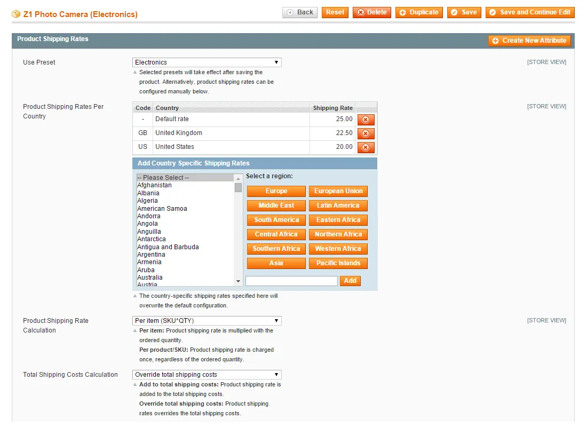
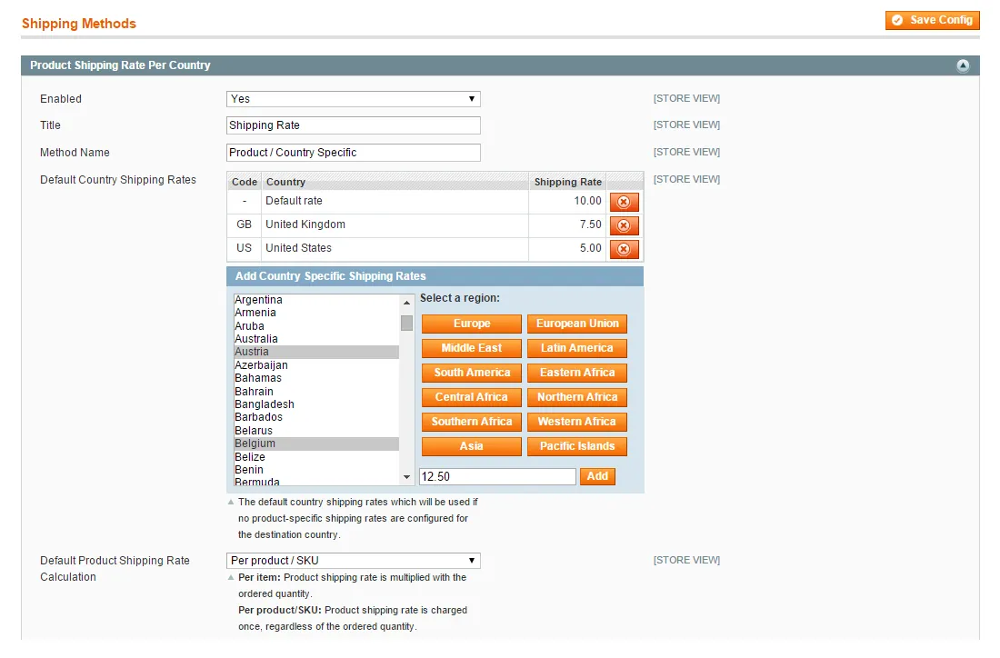
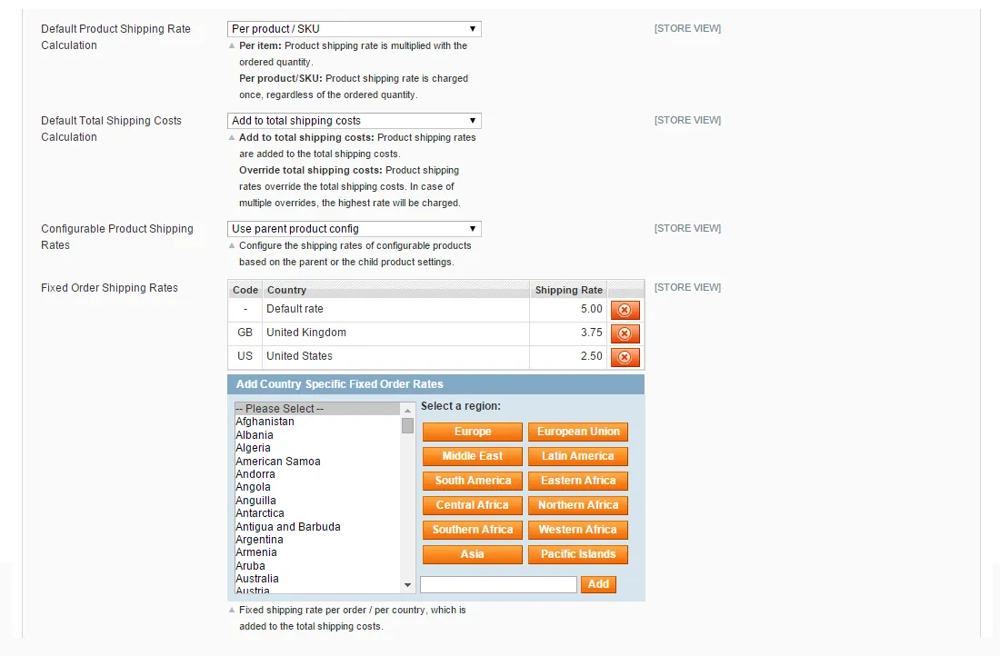
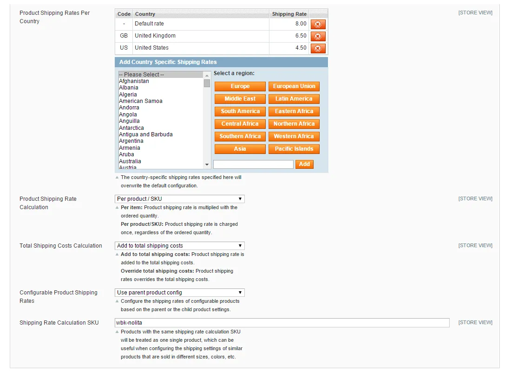
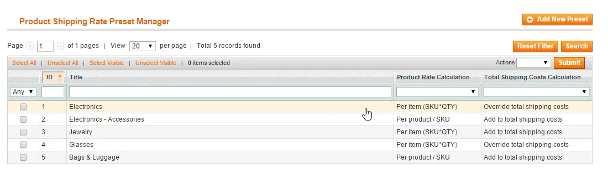
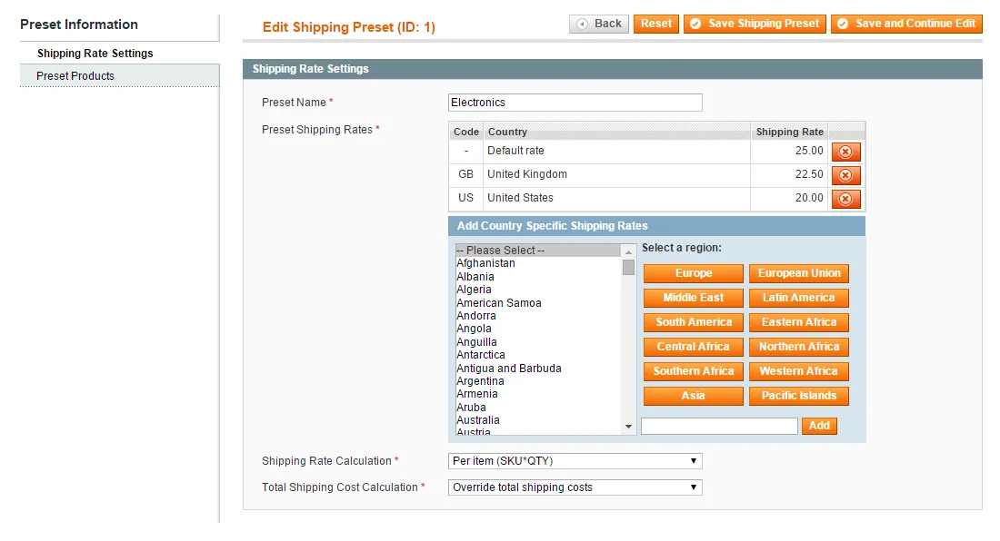
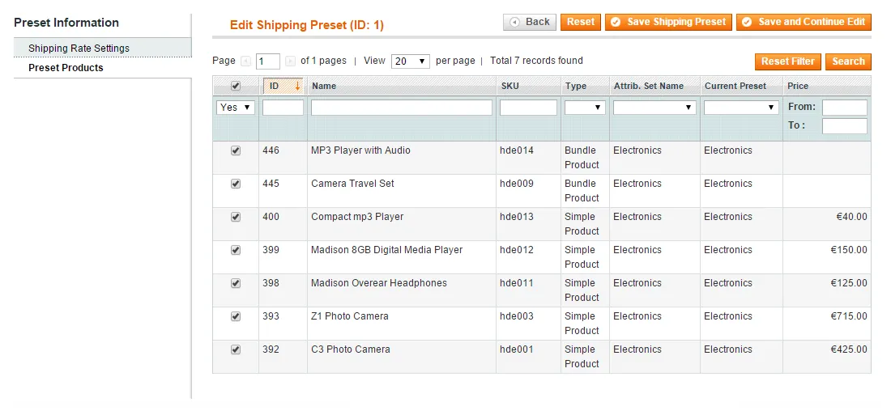

# Product Shipping Rates Per Country for Magento 1 / OpenMage

**Shipping rates per product and per destination country for Magento.**



Adds a shipping method with rates per product (or SKU) and per destination country.

Shipping costs can be calculated per item, per product or per cart, with optional fixed order fees per country and presets for configuring many products at once.

> [!NOTE]
> Product Shipping Rates Per Country is free and open source under the MIT License (since 2026). Plugin Company no longer actively develops this extension, but issues and pull requests are welcome.

## Features

### Shipping rates configuration

- Shipping rates per SKU and per country
- Default rates per destination country or region
- Fixed order shipping fees per country or group of countries
- Built-in region presets for country selection
- Custom presets to configure many products at once
- Configurable product rates based on parent or child product

### Shipping costs calculation

- Calculate shipping costs per item, per product or per cart
- Add product rates to the total shipping costs
- Or use the highest product rate as the total
- Ship small items for free together with large items

## Screenshots

<table>
  <tr>
    <td width="50%" valign="top"><br><sub>Product shipping rates config screen (1 of 2)</sub></td>
    <td width="50%" valign="top"><br><sub>Product shipping rates config screen (2 of 2)</sub></td>
  </tr>
  <tr>
    <td width="50%" valign="top"><br><sub>Configurable product shipping rates</sub></td>
    <td width="50%" valign="top"><br><sub>Product shipping rate preset manager</sub></td>
  </tr>
  <tr>
    <td width="50%" valign="top"><br><sub>Preset shipping rate settings</sub></td>
    <td width="50%" valign="top"><br><sub>Shipping rate preset products</sub></td>
  </tr>
</table>

## Compatibility

- **Magento:** Community Edition 1.4.x – 1.9.x, Enterprise Edition 1.8.x – 1.14.x
- **Latest version:** 1.2.8 (released 2019-04-08)
- **Composer package:** `plugincompany/magento1-product-shipping-rates-per-country`
- **Module:** `Plugincompany_Shippingproduct`

## Installation

### modman

```bash
cd /path/to/magento
modman init   # once per Magento installation
modman clone https://github.com/PluginCompany/magento1-product-shipping-rates-per-country.git
```

modman creates symlinks, so enable *Allow Symlinks* under System > Configuration > Advanced > Developer > Template Settings.

### Composer

With [magento-hackathon/magento-composer-installer](https://github.com/Cotya/magento-composer-installer) (it reads the `modman` file of this repository):

```bash
composer config repositories.plugin.company composer https://plugin.company/
composer require plugincompany/magento1-product-shipping-rates-per-country
```

Your project `composer.json` needs the Magento root directory in its `extra` section (and, with Composer 2.2+, the installer plugin allowed), for example:

```json
{
    "extra": { "magento-root-dir": "./" },
    "config": { "allow-plugins": { "magento-hackathon/magento-composer-installer": true } }
}
```

### Manual installation

Download the ZIP of the latest release from the [tags page](https://github.com/PluginCompany/magento1-product-shipping-rates-per-country/tags) ([1.2.8](https://github.com/PluginCompany/magento1-product-shipping-rates-per-country/archive/refs/tags/1.2.8.zip)) and copy the `app/`, `js/` folders into your Magento root:

```bash
unzip magento1-product-shipping-rates-per-country-1.2.8.zip
cp -R magento1-product-shipping-rates-per-country-1.2.8/app magento1-product-shipping-rates-per-country-1.2.8/js /path/to/magento/
```

Step-by-step instructions are in the [installation guide](docs/02-installing-the-magento-extension.md).

### After installing

Clear the cache (System > Cache Management, or `rm -rf var/cache/*`), then log out of the admin and log in again so the new configuration sections and permissions are loaded.

> [!NOTE]
> Some files of this extension are also shipped by other Plugin Company Magento 1 extensions: `js/plugincompany/jquerynoconflict.js` (also in 8 other extensions). The original ZIP packages simply overwrote each other's copy; with modman or the Composer installer the second extension reports an existing target for these paths.

### Upgrading from a purchased copy

Replace the old files with this release. No license key is needed; your settings and data stay as they are.

## Documentation

- [Documentation in this repository](docs/README.md) (Installation Guide, User Manual, Extension FAQ)
- Online documentation: <https://plugin.company/knowledge-base/docs/magento-product-shipping-rates-per-country/>
- Product page: <https://plugin.company/magento1-extensions/shipping-rates-per-product-per-country.html>

## Changelog

See [CHANGELOG.md](CHANGELOG.md) for the release history.

## Contributing

Found a bug or have an improvement? Please open an [issue](https://github.com/PluginCompany/magento1-product-shipping-rates-per-country/issues) or send a [pull request](https://github.com/PluginCompany/magento1-product-shipping-rates-per-country/pulls). Since the extension is no longer actively developed by Plugin Company, fixes from the community are the best way to keep it working on current Magento 1 / OpenMage and PHP versions.

## License

Plugin Company's code in this repository is released under the [MIT License](LICENSE), Copyright (c) 2014-2026 Plugin Company.

Bundled third-party libraries keep their own licenses; see [THIRD-PARTY-NOTICES.md](THIRD-PARTY-NOTICES.md) for the full list.
