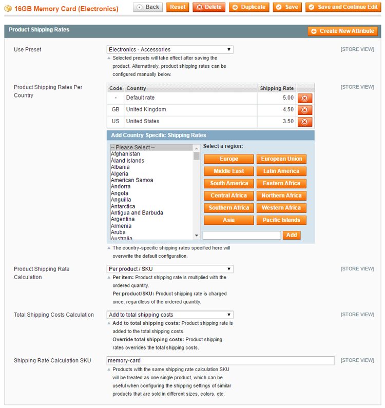

# Configuring Shipping Rates Per Product

To specify the country shipping rates and calculation options per product, navigate to **Catalog > Manage Products**, select a product from the list and click **Product Shipping Rates** in the left side menu.

Using the Product Shipping Rates tab in the product view you can:

- Automatically configure the product shipping rates using a custom shipping rate preset.
- Configure the product shipping rates per country.
- Configure the shipping rate calculation options.
- Configure the shipping rates of configurable products (if applicable).
- Optionally enter a custom shipping rate calculation SKU.

## Using Shipping Rate Presets

If you have created [custom shipping rate presets](./06-configuring-product-shipping-rate-presets.md) you can select one from the preset dropdown menu at the top of the Product Shipping Rates tab.

The selected preset will take affect after the product has been saved, updating the shipping rates and calculation options in the Product Shipping Rates tab accordingly.

Alternatively you can configure the product shipping rates manually using the options below.

## Product Shipping Rates Per Country

The country shipping rates configured for a specific product will automatically override the [default country shipping rates](./04-configuring-the-product-shipping-rates-extension.md#shipping-rates) added in the extension's config screen.

To add product shipping rates, select one or multiple countries from the list box, enter the shipping rate in the input field and click 'Add' or press 'Enter'.

You can use the integrated presets to automatically select multiple countries in the same region.

Select 'Default rate' from the country list box to add a default product shipping rate for all destination countries.

## Product Shipping Rate Calculation

The product shipping rate can be calculated per item or per product/SKU as explained in [Configuring the Product Shipping Rates Extension](./04-configuring-the-product-shipping-rates-extension.md#product-shipping).

Select 'Use default config' to use the default product shipping rate calculation method.

## Total Shipping Costs Calculation

The product shipping rate can be added up to the total shipping costs or override them as explained in [Configuring the Product Shipping Rates Extension](./04-configuring-the-product-shipping-rates-extension.md#total-shipping).

Select 'Use default config' to use the default total shipping costs calculation method.

## Configurable Product Shipping Rates

When configuring the shipping rates and calculation methods of configurable product types, you can choose to use the settings of the parent product for the child product(s). or vice versa.

The child products can be viewed and edited in the Associated Products tab of the Product Information menu.

Select 'Use default config' to use the default configurable product shipping rates settings.

## Shipping Rate Calculation SKU

You can optionally enter a custom shipping rate calculation SKU, which can be useful when configuring the shipping rates of similar products that are sold in different sizes, colors, etc.

Products with the same shipping rate calculation SKU will be treated as one single product when calculating the shipping costs.

For example, a Magento store is selling two memory cards, one 8GB card (hde005) and one 16GB card (hde004). When selecting the 'per product/SKU' calculation method for these memory cards, their shipping rate will be charged twice when the 8GB and 16GB cards are purchased together. By assigning the same shipping rate calculation SKU to both cards, for example 'memory-card', the cards will be treated as one product when purchased together, charging the product shipping rate only once.

---

[Documentation index](./README.md) · [README](../README.md) · [Online version](https://plugin.company/knowledge-base/docs/magento-product-shipping-rates-per-country/user-manual/configuring-shipping-rates-per-product/)
